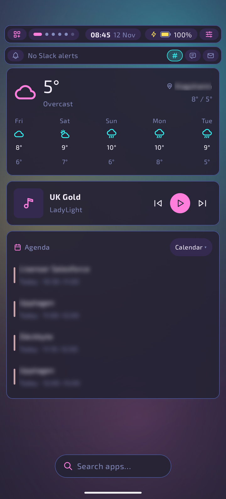
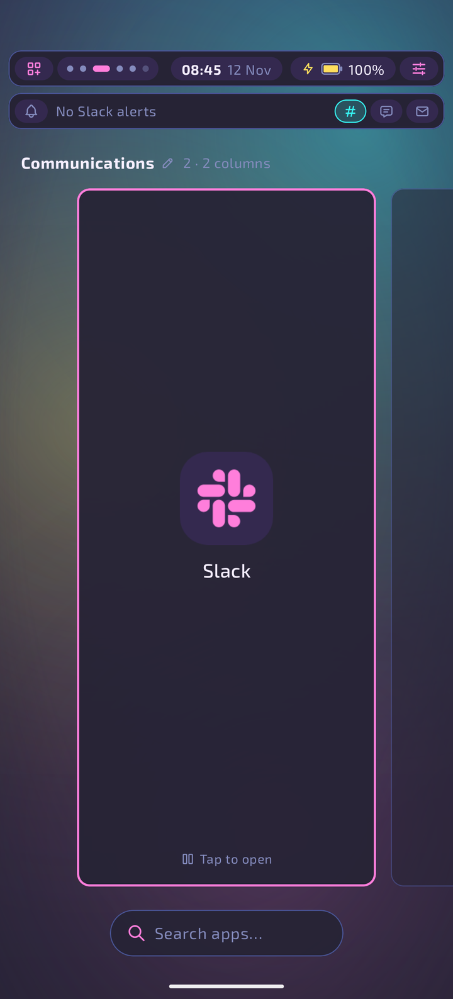
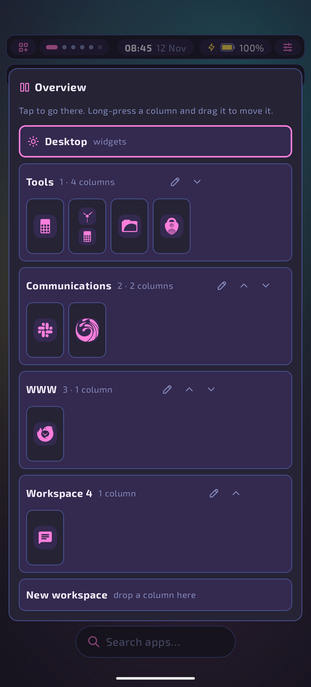
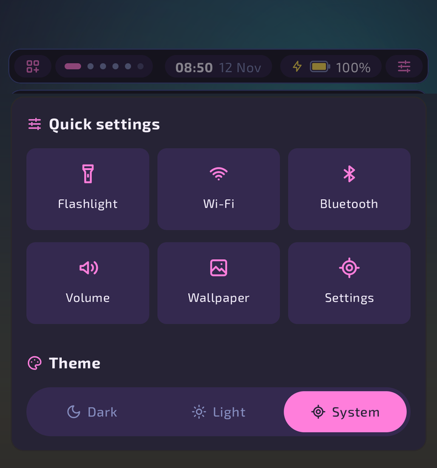
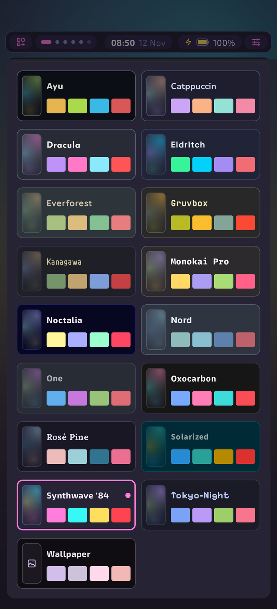
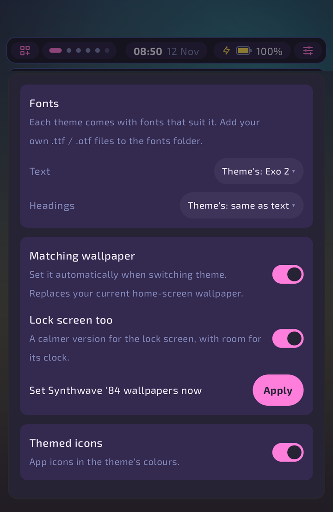
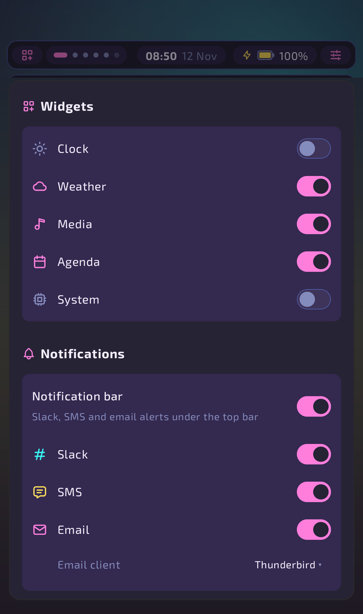

# Scrollwerk

An Android home-screen launcher built on the ideas of [niri](https://github.com/YaLTeR/niri)'s
scrollable tiling: workspaces of app columns on a scrolling strip. It adds a rofi-style app launcher and the look and feel
of the [Noctalia](https://github.com/noctalia-dev/noctalia) shell. Scrollwerk isn't affiliated with niri or Noctalia.

**New to installing apps like this?** Follow [Installation, step by step](#installation-step-by-step).

<p align="center">
  
  
  
</p>
<p align="center"><sub>Home · a workspace · Overview</sub></p>

<p align="center">
  
  
  
  
</p>
<p align="center"><sub>The Control Center, top to bottom: quick settings · themes · fonts and wallpaper · widgets and notifications</sub></p>

## What it does

- **Home:** a vertical stack of pages, like niri's workspaces. Page 1 is the widget desktop. Below it come your workspaces,
  then always one empty workspace. A floating Noctalia bar (launcher · workspace dots · clock · battery ·
  Control Center) replaces the system status bar. The clock stays centred, so with many workspaces the date
  shortens ("Wed 11 Nov" → "11 Nov" → "Wed 11"), or steps aside when even that doesn't fit, instead of crowding
  the capsules beside it. Tap the clock for the full date and week number (in the phone's language); long-press it to
  open your calendar app (the agenda's choice).
- **Now playing:** while music plays, ♪ and the track show up — tap to play / pause, long-press to open the player.
  A paused track stays for two minutes. With the notification bar on, it shows "Title — Artist" there whenever no
  alert is newer than the track; otherwise the bar's date makes way for the title (squeezed to fit, scrolling if long).
  Uses the media widget's notification access; turn off with `bar.media`.
- **Workspaces:** each one is a horizontal strip of columns. The focused column sits in the centre with a focus ring.
  - Tap the focused column to switch to its app. Tap another column to focus it.
  - A column can hold **two apps, which open together in split screen**. This is Android's closest equivalent to a niri column with two windows.
  - Long-press a column to add a second app, move the column left or right, make an app rule for it, or remove it.
  - Adding an app to the empty workspace creates a new one. A workspace disappears once its last column is removed.
  - Home from another app returns you to the workspace you were on. Home or Back on the home screen goes to the desktop page.
  - Android doesn't let a launcher tile or move other apps' windows, so a column is a shortcut to that app's task, not a live window.
- **Overview** (like niri's): pinch in with two fingers on the home screen, or long-press the workspace dots in the bar.
  - Every workspace is shown as a row of small columns, with the desktop on top and "New workspace" at the end.
    The workspace you're on has the focus ring.
  - Tap a workspace to go there.
  - Long-press a column and drag it to reorder it, move it to another workspace, or drop it on "New workspace" to start one.
    A workspace you empty this way disappears.
  - The ↑ / ↓ arrows reorder workspaces. Back or Home closes the Overview.
- **Named workspaces:** tap a workspace's title (or the pencil in the Overview) to name it, e.g. "Work" or "Chat".
  The name replaces "Workspace N" on the page and in the Overview; the number stays next to it, since the bar's dots
  count by number. Clear the field or tap "Remove name" to go back to the number. Names live in `workspaces.json`.
- **App rules** (like niri's window rules) say which workspace an app belongs to:
  - Launching an app with a rule from the launcher, while it's in no workspace yet, adds it to its workspace.
    A workspace named in a rule that doesn't exist yet is created with that name.
  - Long-press it in the launcher for "Add to Chat" instead of "Add to workspace N".
  - Long-press a column and pick **Always put in this workspace** to make a rule (or remove it again).
    It uses the workspace's name, else its number, so name a workspace first if you reorder them.
  - Or write them in `config.json`: `app` is a package name or label, `workspace` a name or number, and
    `"autoAdd": false` keeps the "Add to" label without adding on launch. Later rules win.
- **Desktop widgets** (Noctalia's widget types that work on Android):
  - **Clock:** a big clock whose text contrast follows the wallpaper.
  - **Weather:** current conditions and a 5-day forecast from [Open-Meteo](https://open-meteo.com/), like Noctalia's. Asks for coarse location, or uses `weatherLocation`. Coordinates are rounded to about 1 km before they're sent.
  - **Media:** what's playing, with previous / play-pause / next. Needs "notification access" so it can read media sessions.
  - **Agenda:** your next events over two days, read from Android's calendar storage. Needs calendar access.
    The chip in the card's header picks which app events open in: an installed calendar app, the system default,
    or "Other app…". Tap an event to open it, or the title to open the app.
  - **System:** memory, storage and battery temperature.
- **Notification bar** (off by default; turn it on in the Control Center): a second strip under the bar, styled like it,
  with alerts from **Slack, SMS and email**.
  - It shows the newest alert, then a capsule per source with its count. Tap a capsule to show only that source's alerts in the
    strip and the list; tap it again for all of them. Long-press a capsule to open Slack, your default SMS app or your email client.
  - Tap the strip to drop down the list. It has an "Open …" link while a source is selected.
  - Tap an alert to open it (the message or thread), or × to dismiss it, which also clears it from the phone. Back closes the list.
  - **Email client:** choose which app counts as email in the Control Center: any installed email app, one from the list,
    or "Other app…" for clients that don't register as one. Long-pressing the email capsule opens that app.
  - **Column badges:** a workspace column whose app has alerts shows a count in the source's colour, on the workspace
    pages and in the Overview. A split column adds up both apps.
  - Uses the same "notification access" as the media widget. Scrollwerk keeps only Slack, SMS and email-client
    notifications, and only in memory while the bar is on. Everything else is dropped as it arrives.
- **Launcher:** tap the search pill or the bar's launcher button. Long-press a result for **Add to workspace N**
  (or **Add to Chat** when the app has a rule).
  - fzf-style fuzzy matching (`gm` → Google Maps). Matched letters are highlighted, and apps you launch often rank higher in search results.
  - Enter or the keyboard's Go key launches the selected row. On a hardware keyboard, use arrows or Tab to move and Esc to close.
  - Calculator: type `12*7` and press Enter to copy `84`.
  - **Unit conversion:** `5 km to mi`, `72 f in c`, `2 cups to ml`, `10 gb to gib`, `100 kmh to mph`, `1,5 h till min`.
    Covers length, mass, temperature, volume (including cooking measures), speed, data and time. Enter copies the number.
  - **Emoji:** start with `:` to search emoji only, by English name or English / Swedish keyword (`:fire`, `:thumbs`,
    `:hjärta`, `:sweden`). Enter or a tap copies it. The list comes from Unicode's CLDR data
    (`tools/gen_emoji.py` rebuilds `assets/emoji.tsv`); emoji the phone's font can't draw are left out.
  - **App shortcuts:** the actions apps offer on long-press ("Compose", "New message", "Do not disturb") show up in
    search after the apps: type part of the shortcut (`comp`) or the app's name (`gmail`). A result's long-press menu
    lists its app's shortcuts too. Android only shares shortcuts with the default home app, so Scrollwerk must be set
    as yours. Turn off with `launcher.shortcuts`.
  - **Settings pages:** `wifi`, `bluetooth`, `battery`, `brightness`, `dev`… open that Settings screen directly.
  - **Contacts:** names match fuzzily. Tap opens the contact; long-press for Call (opens the dialer) or Message.
    The first time, a "Search contacts too" row asks for contacts permission. Names are read on the phone, kept in
    memory while the launcher is open, and never sent anywhere. Refusing turns contacts search off (`launcher.contacts`).
  - **Web search:** the last row searches the web, so Enter on a query with no other match does a web search.
    It uses the phone's web search, or `launcher.webSearchUrl` (for example `"https://duckduckgo.com/?q=%s"`).
  - Settings, contacts and web search only appear under the All chip, and not while picking an app for a workspace.
  - Chips: All, Recent, and app categories. With an empty search, pinned apps come first, then everything A–Z.
  - Long-press a result to pin it or open its app info.
- **Control Center:** pull down on the widgets, or tap the sliders icon in the bar.
  - Quick tiles: flashlight, Wi-Fi, Bluetooth, volume, wallpaper, settings.
  - **Theme switcher:** 16 palettes, each in Dark / Light / System mode, or wallpaper-derived colours.
    Noctalia's ten (Ayu, Catppuccin, Dracula, Eldritch, Gruvbox, Kanagawa, Noctalia, Nord, Rosé Pine, Tokyo-Night)
    plus Everforest, Monokai Pro, One (Atom's One Dark / Light), Oxocarbon (IBM Carbon), Solarized and Synthwave '84.
    The choice is written to `config.json`.
  - **Theme fonts:** each theme comes with a font that suits it, and the palette cards show their names in it:

    | Theme | Font | | Theme | Font |
    |---|---|---|---|---|
    | Kanagawa | ZCOOL QingKe HuangYou headings, Zen Kaku Gothic New text | | Rosé Pine | Lora |
    | Tokyo-Night | Pixelify Sans (pixel, arcade) | | Ayu | Rubik |
    | Gruvbox | JetBrains Mono | | Eldritch | Space Grotesk |
    | Nord | Inter | | Everforest | Quicksand |
    | Catppuccin | Nunito | | Solarized | Source Sans 3 |
    | Dracula | Josefin Sans | | One | Fira Sans |
    | Monokai Pro | Fira Code | | Synthwave '84 | Exo 2 |
    | Oxocarbon | IBM Plex Sans | | Noctalia, wallpaper | the phone's font |

    Headings are everything set in SemiBold or Bold: the clock, workspace and card titles, track names, buttons.
    Picking a theme in the grid switches to its fonts. The **Fonts** box in the Control Center then overrides them
    until you pick another theme:
    - **Text** (`theme.font`): the theme's font, the phone's (`"system"`), or any font by name.
    - **Headings** (`theme.headingFont`): the theme's choice, the text font's own bold (`"text"`), or any font by name.

    Seventeen more fonts can be picked by hand, mostly for headings: Black Han Sans, Black Ops One, Chakra Petch,
    Do Hyeon, DotGothic16, Goldman, Gugi, Kdam Thmor Pro, Oxanium, Russo One, Sarpanch, Shojumaru, Squada One,
    Tektur, Turret Road, Wallpoet and ZCOOL KuaiLe. Display fonts are scaled so their capitals stand as tall as the
    text fonts', so a heading in any of them sits at the size the app asks for, and every font's line height covers
    its own tallest and deepest letters, so nothing is cut off. The fonts carry Latin characters (å ä ö included);
    anything else comes from the phone's fonts. Several have one weight, so their bold is drawn by Android.
  - **Your own fonts:** put `.ttf` / `.otf` files in `fonts/` next to `config.json`. Files named like
    `JapanRamen-Regular.otf` and `JapanRamen-Bold.otf` become one font, "JapanRamen", with those weights; a file with no
    weight in its name is the regular. They show up in the Fonts box right away, and a palette file can name them with
    `"font"` and `"headingFont"`. Use fonts whose license allows it; they stay on your phone.

    ```sh
    adb push JapanRamen-Regular.otf /sdcard/Android/data/dev.scrollwerk.launcher/files/fonts/
    ```
  - **Kanagawa's workspace numbers** stand in front of each title as brush kanji (一, 二, 三…), on the page and in the
    Overview, written in Yuji Syuku.
  - **Your own palettes:** put colour-scheme files in `palettes/` next to `config.json` and they join the theme grid,
    with their own matching wallpapers. Two formats work:
    - Noctalia colour schemes: JSON with `dark` and `light` objects of `mPrimary`, `mSurface`, `mOnSurface`, … (plain
      `primary`, `surface`, … too). Roles a file leaves out are derived; a file without `dark` / `light` is used for both.
    - base16 / base24 schemes (`.yaml` or `.json` with `base00`…`base0F`, e.g. from tinted-theming). Blue becomes
      primary, purple secondary, cyan tertiary and red error; the opposite light/dark mode is derived by flipping the
      background ramp.

    The palette is named by the file's `name` (or `scheme`) field, else its file name, and replaces a built-in of the same
    name. A Noctalia file can pick fonts too, e.g. `"font": "Lora", "headingFont": "Gugi"`. Changes show up right away. A file that
    can't be read is named in the error banner; the rest still load.

    ```sh
    adb push gruvbox-dark-medium.yaml /sdcard/Android/data/dev.scrollwerk.launcher/files/palettes/
    ```
  - **Themed icons** (off by default): app icons drawn in the palette's colours, like Android's themed icons, in the
    launcher, the workspaces and the Overview. Apps that ship a monochrome icon (Android 13+) use it. For the rest,
    Scrollwerk takes the parts of the normal icon that stand out from its background colour; a one-colour logo
    becomes its silhouette.
  - **Matching wallpapers:** each palette has a wallpaper generated in its own colours, in dark and light variants, sized to
    your screen: a gradient base, soft glows in the accent colours and a vignette. Each palette card shows a preview.
    "Apply" sets it once. The **Matching wallpaper** toggle (off by default) sets it automatically whenever you switch theme.
  - **Lock screen too** (off by default) also sets a lock-screen version: darker and calmer so the lock clock stays readable,
    with a soft glow behind the clock and the accent glows gathered low on the screen.
    Turning it on sets it right away; after that it follows "Apply" and theme switches.
  - Android doesn't let an app back up the wallpapers it replaces, so save yours first if you want to keep them.
  - **Widgets:** a switch for each desktop widget (clock, weather, media, agenda, system), saved to `config.json`.
  - **Notifications:** the notification bar switch, a switch per source (Slack, SMS, email), and the email client.
- Back or Home closes whatever is open. Back on the bare home screen does nothing.

## Installation, step by step

No experience needed. There's no ready-made download yet, so you let a free program called **Android Studio** build
Scrollwerk on your computer and put it on your phone over a USB cable. Plan for about an hour the first time, most of it
waiting for downloads.

### What you need

- An Android phone with **Android 12 or newer**. To check: *Settings → About phone → Android version*.
- A Windows, Mac or Linux computer with about **15 GB of free space**.
- A **USB cable that carries data**, not only power. The cable that came with the phone usually does.

### 1. Install Android Studio on your computer

1. Go to [developer.android.com/studio](https://developer.android.com/studio) and click **Download Android Studio**.
2. Install it like any other program, and accept the suggested settings.
3. Open it once. It downloads more parts the first time ("SDK"); let it finish.

### 2. Download Scrollwerk

1. Open [github.com/ms4ndst/scrollwerk](https://github.com/ms4ndst/scrollwerk).
2. Click the green **Code** button, then **Download ZIP**.
3. Unzip the file, for example to your Documents folder. You get a folder called `scrollwerk-main`.

### 3. Let your phone accept apps from the computer

You only do this once. The menu names differ a little between phone makers.

1. On the phone, open *Settings → About phone*. On Samsung it's *Settings → About phone → Software information*.
2. Tap **Build number** seven times in a row. The phone says "You are now a developer".
3. Go back to *Settings*, find **Developer options** (often under *System*), and turn on **USB debugging**.

### 4. Install Scrollwerk

1. Connect the phone to the computer with the USB cable, and unlock the phone.
2. If the phone asks **"Allow USB debugging?"**, tick *Always allow from this computer* and tap **Allow**.
3. In Android Studio, choose **File → Open** (or **Open** on the welcome screen) and pick the `scrollwerk-main` folder.
4. Wait until the bar at the bottom of Android Studio stops working ("Gradle sync"). The first time takes a few
   minutes. If it offers to install something that's missing, click the link and accept.
5. At the top of the window, check that your **phone's name** is shown in the device list.
6. Click the **green ▶ Run** button next to it. After a minute or two, Scrollwerk is installed and opens on the phone.

### 5. Make Scrollwerk your home screen

1. Press the phone's **Home** button (or swipe up from the bottom edge).
2. When the phone asks which app to use, pick **Scrollwerk** and tap **Always**.
3. If it doesn't ask: *Settings → Apps → Default apps → Home app → Scrollwerk*.

### 6. Turn on the extras (optional)

Scrollwerk works right away. These switch on the parts that need your permission:

- **Music controls and the notification bar** need *notification access*. Tap **Enable** on the media card or
  **Allow** on the notification bar; it opens the right page in Settings. Turn Scrollwerk on there.
- **Weather** asks for your rough location the first time. You can type a city into `config.json` instead (see [Config](#config)).
- **Agenda** asks for your calendar the first time you see it.
- **Contacts** in search are asked for from the launcher's "Search contacts too" row.

You can unplug the cable now. Scrollwerk stays on the phone.

### Updating to a newer version

Download the ZIP again (step 2), open the new folder in Android Studio, and press **▶ Run** with the phone connected.
Use the same computer as the first time, and your themes, workspaces and settings are kept.

### Going back to your old home screen

- **Just switch:** *Settings → Apps → Default apps → Home app*, and pick the one you had before.
- **Remove Scrollwerk completely:** switch back first, then *Settings → Apps → Scrollwerk → Uninstall*. This also
  deletes its settings. Wallpapers that Scrollwerk set stay until you change them.

### If something goes wrong

- **The phone isn't in Android Studio's device list:** unlock the phone, try another cable or USB port, and check that
  *USB debugging* is still on. Pull the cable out and back in, and look for the *Allow USB debugging?* question.
- **"Gradle sync failed" or a red error at the bottom:** click the blue link in the message (it usually installs a
  missing part), then choose *File → Sync Project with Gradle Files*.
- **"INSTALL_FAILED_OLDER_SDK" or similar:** the phone runs an Android version older than 12, which Scrollwerk doesn't support.
- **The phone never asks which home app to use:** set it by hand under *Settings → Apps → Default apps → Home app*.
- **"INSTALL_FAILED_UPDATE_INCOMPATIBLE" when updating:** the old version was installed from a different computer.
  Update from the same computer as before, or accept removing the old version, which also removes its settings.

## Config

`config.json` is written with every default filled in. Changes apply as soon as the file is saved while the home screen
is showing (an `adb push` or an editor's save), and the file is re-read whenever the home screen comes back.
Comments and trailing commas are allowed. If an edit breaks the file, a banner shows the error and the last good config stays in use.
The theme switcher rewrites the file, so any comments you added are lost.

```jsonc
{
  "theme":    { "palette": "Noctalia" /* any palette name, or "wallpaper" */, "mode": "dark" /* light, system */,
                "cornerRadiusScale": 1.0, "matchingWallpaper": false, "matchingLockScreen": false, "themedIcons": false,
                "font": "theme" /* the palette's font, "system", or a font name such as "Inter" */,
                "headingFont": "theme" /* the palette's, "text" (the text font's bold), or a font name */ },
  "bar":      { "hideSystemStatusBar": true, "floating": true, "use24Hour": null, "showDate": true, "media": true },
  "launcher": { "searchPosition": "bottom" /* or "top" */, "sortByUsage": true, "categories": true,
                "calculator": true, "shortcuts": true, "settings": true, "contacts": true,
                "webSearch": true, "webSearchUrl": null /* e.g. "https://duckduckgo.com/?q=%s" */,
                "emoji": true, "units": true },
  "widgets":  { "clock": true, "weather": true, "media": true, "agenda": true, "system": true,
                "weatherLocation": null /* e.g. "Stockholm" */, "temperatureUnit": "celsius",
                "calendarApp": null /* package name, e.g. "org.fossify.calendar"; null = system default */ },
  "notifications": { "enabled": false, "slack": true, "sms": true, "email": true,
                     "emailApp": null /* package name, e.g. "com.fsck.k9"; null = any email app */ },
  "rules": [ { "app": "com.Slack", "workspace": "Chat" }, { "app": "Firefox", "workspace": "2", "autoAdd": false } ]
}
```

```sh
adb pull /sdcard/Android/data/dev.scrollwerk.launcher/files/config.json
adb push config.json /sdcard/Android/data/dev.scrollwerk.launcher/files/config.json
```

Launch counts, recents and pins live in the app's private `usage.json`, and workspaces in `workspaces.json`.
Ten palettes are generated from Noctalia's `builtin_palettes.cpp` (MIT). The theme fonts come from
[Google Fonts](https://fonts.google.com) under the SIL Open Font License 1.1; their licenses ship in
`assets/licenses/fonts/`, and `tools/gen_fonts.py` rebuilds them.

## Build

Toolchain: AGP 9.5, Gradle 9.9 (wrapper checked in), Kotlin 2.4, compileSdk 37, minSdk 31.
Runs on JDK 21+ — Android Studio's bundled JDK 25 works.

**Android Studio:** open the folder and sync.

**Command line:** point `JAVA_HOME` at a JDK 21+ (e.g. Studio's `jbr` directory), then:

```sh
./gradlew :app:testDebugUnitTest      # search providers, emoji & units, workspaces & rules, palettes & import,
                                      # icon glyphs, notification filtering, weather parsing, config
./gradlew :app:installDebug           # then pick "Scrollwerk" as the home app
```

On a new phone, after installing:

1. Press Home and pick **Scrollwerk**, or set it in Settings → Apps → Default apps → Home app.
2. For the media widget, Now playing and the notification bar, grant notification access. The widget's **Enable**
   button and the bar's **Allow** button both open the right settings page.
3. Turn the notification bar on in the Control Center (**Notifications → Notification bar**) and pick your email client.

Everything else is asked for when you first use it: location for weather (or set `weatherLocation`), calendar for the
agenda, and contacts from the launcher's "Search contacts too" row.
