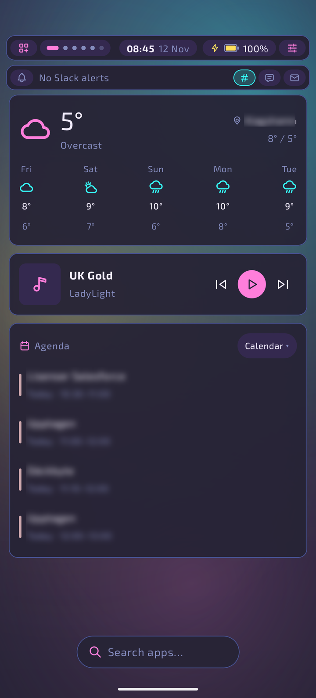
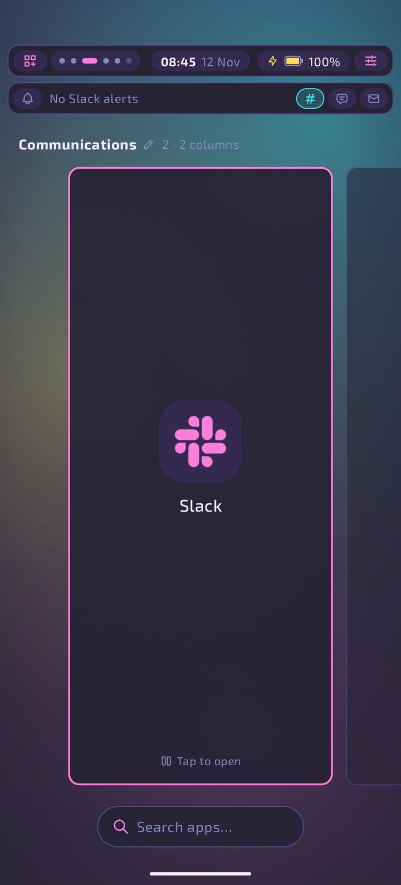
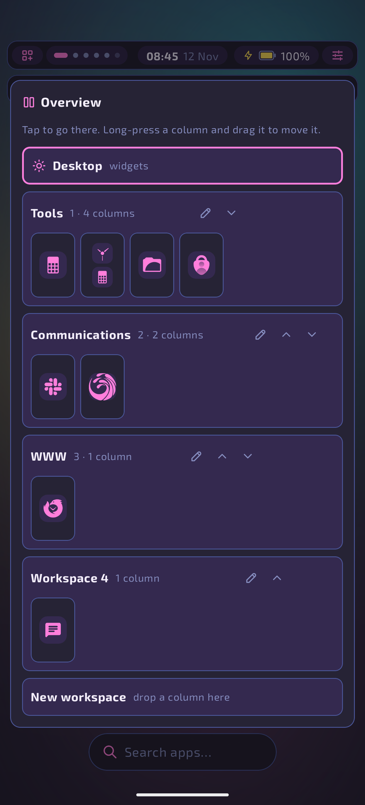
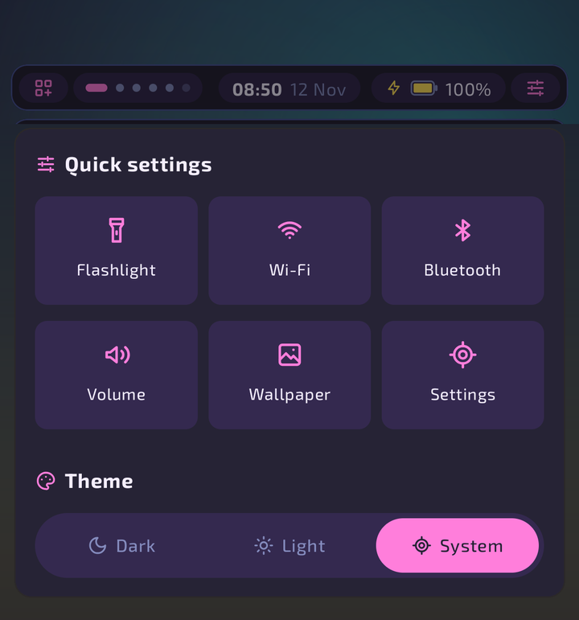
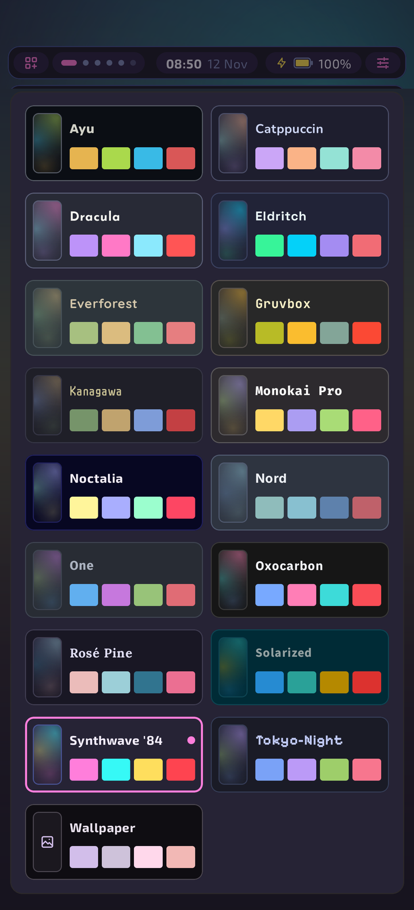
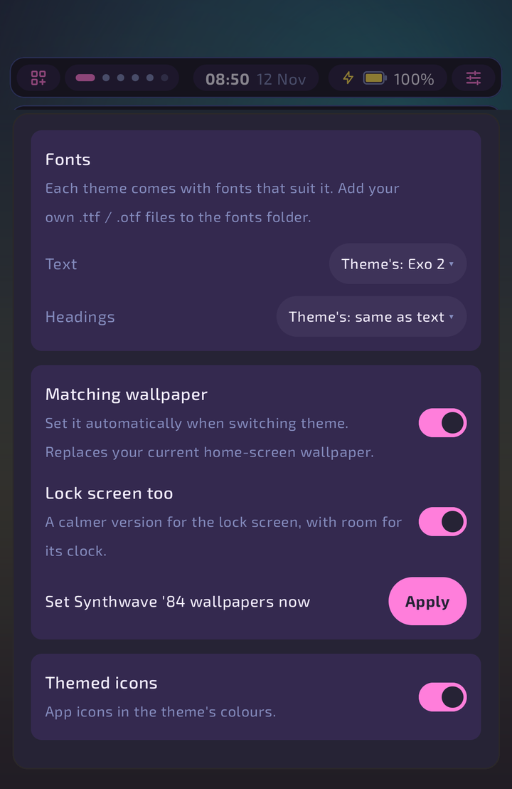
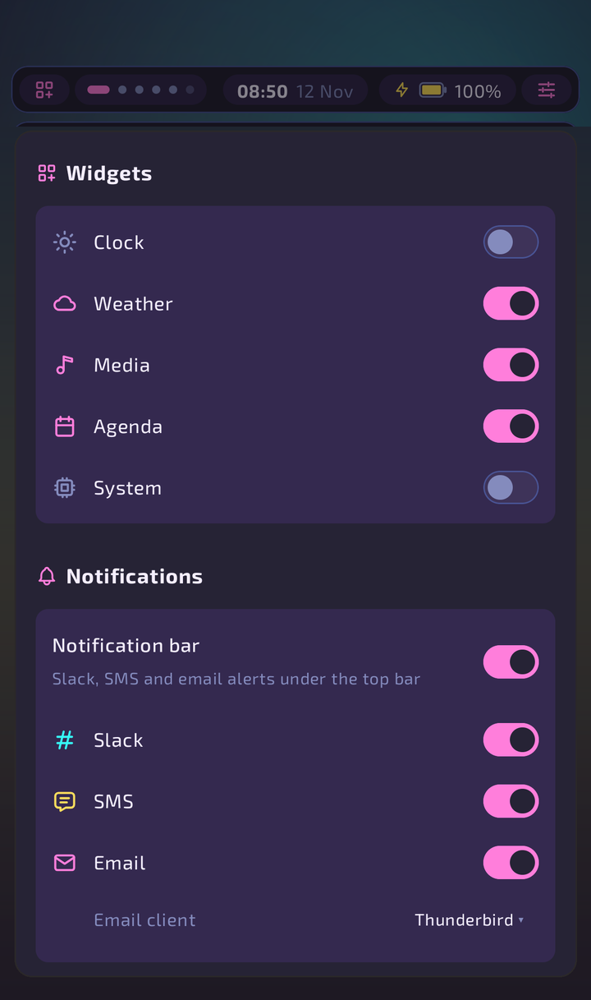

# Scrollwerk

An Android home-screen launcher built on the ideas of [niri](https://github.com/YaLTeR/niri)'s
scrollable tiling: workspaces of app columns on a scrolling strip. It adds a rofi-style app launcher and the look and feel
of the [Noctalia](https://github.com/noctalia-dev/noctalia) shell. Scrollwerk isn't affiliated with niri or Noctalia.

It also has an Overview of all workspaces, a notification bar for Slack, Signal, WhatsApp, Telegram, Claude, SMS and email, an
[Ask pill](#assistant-a-local-ai-on-your-phone) for a local AI on your phone, and [sixteen themes](#themes), each with
its own fonts and matching home and lock-screen wallpapers.

**New to installing apps like this?** Follow [Installation, step by step](#installation-step-by-step).

<p align="center">
  
  
  
</p>
<p align="center"><sub>Home · a workspace · Overview</sub></p>

<p align="center">
  
  
  
  
</p>
<p align="center"><sub>The Control Center, top to bottom: quick settings · themes · fonts and wallpaper · widgets and notifications</sub></p>

## What it does

- **Home:** a vertical stack of pages, like niri's workspaces. Page 1 is the widget desktop. Below it come your workspaces,
  then always one empty workspace. A floating Noctalia bar (launcher · workspace dots · clock · battery ·
  Control Center) replaces the system status bar. The clock stays centred, so with many workspaces the date
  shortens ("Wed 11 Nov" → "11 Nov" → "Wed 11"), or steps aside when even that doesn't fit, instead of crowding
  the capsules beside it. Tap the clock for the full date and week number (in the phone's language); long-press it to
  open your calendar app (the agenda's choice).
- **Now playing:** while music plays, ♪ and the track show up — tap to play / pause, long-press to open the player.
  A paused track stays for two minutes. With the notification bar on, it shows "Title — Artist" there whenever no
  alert is newer than the track; otherwise the bar's date makes way for the title (squeezed to fit, scrolling if long).
  Uses the media widget's notification access; turn off with `bar.media`.
- **Workspaces:** each one is a horizontal strip of columns. The focused column sits in the centre with a focus ring.
  - Tap the focused column to switch to its app. Tap another column to focus it.
  - A column can hold **two apps, which open together in split screen**. This is Android's closest equivalent to a niri column with two windows.
  - Long-press a column to add a second app, move the column left or right, make an app rule for it, or remove it.
  - Adding an app to the empty workspace creates a new one. A workspace disappears once its last column is removed.
  - Home from another app returns you to the workspace you were on. Home or Back on the home screen goes to the desktop page.
  - Android doesn't let a launcher tile or move other apps' windows, so a column is a shortcut to that app's task, not a live window.
- **Overview** (like niri's): pinch in with two fingers on the home screen, or long-press the workspace dots in the bar.
  - Every workspace is shown as a row of small columns, with the desktop on top and "New workspace" at the end.
    The workspace you're on has the focus ring.
  - Tap a workspace to go there.
  - Long-press a column and drag it to reorder it, move it to another workspace, or drop it on "New workspace" to start one.
    A workspace you empty this way disappears.
  - The ↑ / ↓ arrows reorder workspaces. Back or Home closes the Overview.
- **Named workspaces:** tap a workspace's title (or the pencil in the Overview) to name it, e.g. "Work" or "Chat".
  The name replaces "Workspace N" on the page and in the Overview; the number stays next to it, since the bar's dots
  count by number. Clear the field or tap "Remove name" to go back to the number. Names live in `workspaces.json`.
- **App rules** (like niri's window rules) say which workspace an app belongs to:
  - Launching an app with a rule from the launcher, while it's in no workspace yet, adds it to its workspace.
    A workspace named in a rule that doesn't exist yet is created with that name.
  - Long-press it in the launcher for "Add to Chat" instead of "Add to workspace N".
  - Long-press a column and pick **Always put in this workspace** to make a rule (or remove it again).
    It uses the workspace's name, else its number, so name a workspace first if you reorder them.
  - Or write them in `config.json`: `app` is a package name or label, `workspace` a name or number, and
    `"autoAdd": false` keeps the "Add to" label without adding on launch. Later rules win.
- **Desktop widgets** (Noctalia's widget types that work on Android):
  - **Clock:** a big clock whose text contrast follows the wallpaper.
  - **Weather:** current conditions and a 5-day forecast from [Open-Meteo](https://open-meteo.com/), like Noctalia's. Asks for coarse location, or uses `weatherLocation`. Coordinates are rounded to about 1 km before they're sent.
  - **Media:** what's playing, with previous / play-pause / next. Needs "notification access" so it can read media sessions.
  - **Agenda:** your next events over two days, read from Android's calendar storage. Needs calendar access.
    The chip in the card's header picks which app events open in: an installed calendar app, the system default,
    or "Other app…". Tap an event to open it, or the title to open the app.
  - **Notes** (off by default): `notes.md`, next to `config.json`, as a card. Tap it to open the editor, a panel
    above the keyboard; it saves as you type, and **Done**, Back or a tap outside closes it.
    - **Formatting without Markdown:** the **Checkbox**, **List** and **Heading** buttons turn the cursor's line (or every
      selected line) into that kind; press again to undo. Enter on a checkbox or list line starts the next one, Enter on
      an empty one ends the list, and backspace right after ☐ or • removes it. The editor shows ☐, ☑, • and bold headings.
    - Tick checkboxes straight on the card.
    - The file stays plain Markdown (`- [ ] milk`, `- [x] done`, `- item`, `# Title`), so it reads well anywhere. Because it's a plain file, you can edit it from a computer over USB or sync it
    with Syncthing; Scrollwerk shows changes right away. Long notes show their first 12 lines on the card.
  - **System:** memory, storage and battery temperature.
- **Notification bar** (off by default; turn it on in the Control Center): a second strip under the bar, styled like it,
  with alerts from **Slack, Signal, WhatsApp (and WhatsApp Business), Telegram (and Telegram X), Claude, SMS and email**.
  A chat app's capsule only shows while that app is installed.
  - It shows the newest alert, then a capsule with a count for each source that has alerts, newest first. Up to three
    fit; a "+2" capsule stands for the rest and opens the list. Sources without alerts have no capsule, so the message keeps the room.
  - Tap a capsule to show only that source's alerts in the strip and the list; tap it again for all of them. Long-press a
    capsule to open that app: the chat app, your default SMS app or your email client.
  - Tap the strip to drop down the list, even with no alerts. It starts with a chip for every source, alerts or not, which
    work like the capsules (tap to filter, long-press to open the app), and has an "Open …" link while a source is selected.
  - Tap an alert to open it (the message or thread), or × to dismiss it, which also clears it from the phone. Back closes the list.
  - **Reply in place:** alerts whose app offers a reply in the phone's own notification shade (WhatsApp, Signal, Telegram,
    Slack, Google Messages, most email apps) get a reply arrow. Tap it, type, and send: the app sends it exactly as if you'd
    replied from the shade, and the alert shows "Sent". Alerts without a reply action have no arrow.
  - **Email client:** choose which app counts as email in the Control Center: any installed email app, one from the list,
    or "Other app…" for clients that don't register as one. Long-pressing the email capsule opens that app.
  - **Column badges:** a workspace column whose app has alerts shows a count in the source's colour, on the workspace
    pages and in the Overview. A split column adds up both apps.
  - Uses the same "notification access" as the media widget. Scrollwerk keeps only notifications from those chat apps, the SMS app and the
    email client, and only in memory while the bar is on. Everything else is dropped as it arrives.
- **Assistant** (off by default): an **Ask…** pill beside the search pill opens a chat with a local AI app on your
  phone. Answers stream in as they're written, and nothing is sent anywhere else. See
  [Assistant](#assistant-a-local-ai-on-your-phone).
- **Launcher:** tap the search pill or the bar's launcher button. Long-press a result for **Add to workspace N**
  (or **Add to Chat** when the app has a rule).
  - fzf-style fuzzy matching (`gm` → Google Maps). Matched letters are highlighted, and apps you launch often rank higher in search results.
  - Enter or the keyboard's Go key launches the selected row. On a hardware keyboard, use arrows or Tab to move and Esc to close.
  - Calculator: type `12*7` and press Enter to copy `84`.
  - **Unit conversion:** `5 km to mi`, `72 f in c`, `2 cups to ml`, `10 gb to gib`, `100 kmh to mph`, `1,5 h till min`.
    Covers length, mass, temperature, volume (including cooking measures), speed, data and time. Enter copies the number.
  - **Emoji:** start with `:` to search emoji only, by English name or English / Swedish keyword (`:fire`, `:thumbs`,
    `:hjärta`, `:sweden`). Enter or a tap copies it. The list comes from Unicode's CLDR data
    (`tools/gen_emoji.py` rebuilds `assets/emoji.tsv`); emoji the phone's font can't draw are left out.
  - **App shortcuts:** the actions apps offer on long-press ("Compose", "New message", "Do not disturb") show up in
    search after the apps: type part of the shortcut (`comp`) or the app's name (`gmail`). A result's long-press menu
    lists its app's shortcuts too. Android only shares shortcuts with the default home app, so Scrollwerk must be set
    as yours. Turn off with `launcher.shortcuts`.
  - **Settings pages:** `wifi`, `bluetooth`, `battery`, `brightness`, `dev`… open that Settings screen directly.
  - **Contacts:** names match fuzzily. Tap opens the contact; long-press for Call (opens the dialer) or Message.
    The first time, a "Search contacts too" row asks for contacts permission. Names are read on the phone, kept in
    memory while the launcher is open, and never sent anywhere. Refusing turns contacts search off (`launcher.contacts`).
  - **Web search:** the last row searches the web, so Enter on a query with no other match does a web search.
    It uses the phone's web search, or `launcher.webSearchUrl` (for example `"https://duckduckgo.com/?q=%s"`).
  - Settings, contacts and web search only appear under the All chip, and not while picking an app for a workspace.
  - Chips: All, Recent, and app categories. With an empty search, pinned apps come first, then everything A–Z.
  - Long-press a result to pin it or open its app info.
- **Control Center:** pull down on the widgets, or tap the sliders icon in the bar. Top to bottom:
  - **Quick settings:** flashlight, Wi-Fi, Bluetooth, volume, wallpaper, settings.
  - **Theme:** Dark / Light / System, and the theme grid with every palette, each card in its own colours and fonts
    with a preview of its wallpaper. See [Themes](#themes).
  - **Fonts:** a Text and a Headings chooser.
  - **Matching wallpaper** and **Lock screen too**, with an **Apply** button for the current theme.
  - **Themed icons.**
  - **Widgets:** a switch for each desktop widget (clock, weather, media, agenda, notes, system).
  - **Notifications:** the notification bar switch, a switch per source (Slack, Signal, WhatsApp, Telegram, Claude, SMS, email;
    "Not installed" under apps the phone doesn't have), and the email client.
  - **Assistant:** the Ask pill switch, the local AI app's address, which model to ask, and whether it's connected.
  - **Backup:** **Back up…** saves your config, workspaces, app usage (launch counts, recents, pins), notes, palettes and fonts
    to one `.zip` wherever you pick (Downloads, a cloud folder, …). **Restore…** reads one back: it says what it will
    replace and waits for **Restore**, and refuses a file that isn't a Scrollwerk backup or has a broken config. Palettes and
    fonts are added; ones you have that aren't in the backup stay. Use it before reinstalling or when moving to a new phone.

    Everything you change here is written to `config.json`.
- Back or Home closes whatever is open. Back on the bare home screen does nothing.

## Themes

Sixteen themes, each with a dark and a light version: pick **Dark**, **Light** or **System** (follows the phone) in the
Control Center. Each theme also brings its own fonts and, if you want, matching wallpapers.

| Theme | Look | Text font | Heading font |
|---|---|---|---|
| Ayu | warm amber and lime on near-black | Rubik | Rubik |
| Catppuccin | soft pastels: mauve, peach, teal | Nunito | Nunito |
| Dracula | purple, pink and cyan on dark grey | Josefin Sans | Josefin Sans |
| Eldritch | neon green and cyan on deep navy | Space Grotesk | Space Grotesk |
| Everforest | gentle greens and sand, low contrast | Quicksand | Quicksand |
| Gruvbox | retro yellows and greens on warm brown-black | JetBrains Mono | JetBrains Mono |
| Kanagawa | muted green, sand and wave blue, after Hokusai's prints | Zen Kaku Gothic New | ZCOOL QingKe HuangYou |
| Monokai Pro | yellow, violet and lime on charcoal | Fira Code | Fira Code |
| Noctalia | pale yellow and lavender on deep indigo (Noctalia's own) | the phone's | the phone's |
| Nord | arctic frost blues | Inter | Inter |
| One | Atom's One Dark / Light: blue, purple, green | Fira Sans | Fira Sans |
| Oxocarbon | IBM Carbon: blue, pink and teal on black | IBM Plex Sans | IBM Plex Sans |
| Rosé Pine | rose, foam and pine on muted dark | Lora | Lora |
| Solarized | the classic blue, cyan and yellow on deep teal / cream | Source Sans 3 | Source Sans 3 |
| Synthwave '84 | neon pink, cyan and gold on a purple night | Exo 2 | Exo 2 |
| Tokyo-Night | city-night blue and purple | Pixelify Sans (pixel, arcade) | Pixelify Sans |

There is also **Wallpaper**, which takes its colours from your current wallpaper (Android's Material You) and uses the
phone's font. Kanagawa additionally writes each workspace's number as brush kanji (一, 二, 三…) in front of its title,
on the page and in the Overview.

### Fonts

Headings are everything set in SemiBold or Bold: the clock, workspace and card titles, track names, buttons. Picking a
theme in the grid switches to its fonts. The **Fonts** box in the Control Center then overrides them until you pick
another theme:

- **Text** (`theme.font`): the theme's font, the phone's (`"system"`), or any font by name.
- **Headings** (`theme.headingFont`): the theme's choice, the text font's own bold (`"text"`), or any font by name.

Every font is listed drawn in itself, and the theme cards show their names in their own fonts. Besides the theme fonts
above, seventeen more can be picked, mostly for headings: Black Han Sans, Black Ops One, Chakra Petch, Do Hyeon,
DotGothic16, Goldman, Gugi, Kdam Thmor Pro, Oxanium, Russo One, Sarpanch, Shojumaru, Squada One, Tektur, Turret Road,
Wallpoet and ZCOOL KuaiLe.

- Display fonts are scaled so their capitals stand as tall as the text fonts', so a heading in any of them sits at the
  size the app asks for.
- Every font's line height covers its own tallest and deepest letters, so nothing is cut off.
- The fonts carry Latin characters (å ä ö included); anything else comes from the phone's fonts. Several have one
  weight, so their bold is drawn by Android.

**Your own fonts:** put `.ttf` / `.otf` files in `fonts/` next to `config.json`. Files named like
`JapanRamen-Regular.otf` and `JapanRamen-Bold.otf` become one font, "JapanRamen", with those weights; a file with no
weight in its name is the regular. They show up in the Fonts box right away, and a palette file can name them with
`"font"` and `"headingFont"`. A file Android can't read is named in the error banner. Use fonts whose license allows
it; they stay on your phone.

```sh
adb push JapanRamen-Regular.otf /sdcard/Android/data/dev.scrollwerk.launcher/files/fonts/
```

### Your own palettes

Put colour-scheme files in `palettes/` next to `config.json` and they join the theme grid, with their own matching
wallpapers. Two formats work:

- **Noctalia colour schemes:** JSON with `dark` and `light` objects of `mPrimary`, `mSurface`, `mOnSurface`, … (plain
  `primary`, `surface`, … too). Roles a file leaves out are derived; a file without `dark` / `light` is used for both.
  It can pick fonts too, e.g. `"font": "Lora", "headingFont": "Gugi"`.
- **base16 / base24 schemes** (`.yaml` or `.json` with `base00`…`base0F`, e.g. from tinted-theming). Blue becomes
  primary, purple secondary, cyan tertiary and red error; the opposite light/dark mode is derived by flipping the
  background ramp.

The palette is named by the file's `name` (or `scheme`) field, else its file name, and replaces a built-in of the same
name. Changes show up right away. A file that can't be read is named in the error banner; the rest still load.

```sh
adb push gruvbox-dark-medium.yaml /sdcard/Android/data/dev.scrollwerk.launcher/files/palettes/
```

### Matching wallpapers

- Each palette has a wallpaper generated in its own colours, in dark and light versions, sized to your screen: a
  gradient base, soft glows in the accent colours and a vignette. Each theme card shows a preview.
- **Apply** sets it once. The **Matching wallpaper** switch (off by default) sets it whenever you switch theme.
- **Lock screen too** (off by default) also sets a lock-screen version: darker and calmer so the lock clock stays
  readable, with a soft glow behind the clock and the accent glows gathered low on the screen. Turning it on sets it
  right away; after that it follows Apply and theme switches.
- Android doesn't let an app back up the wallpapers it replaces, so save yours first if you want to keep them.

### Themed icons

Off by default. App icons, and the icons of app shortcuts, are drawn in the theme's colours, like Android's themed
icons, in the launcher, the workspaces and the Overview. Apps that ship a monochrome icon (Android 13+) use it. For the
rest, Scrollwerk takes the parts of the normal icon that stand out from its background colour; a one-colour logo
becomes its silhouette.

## Assistant: a local AI on your phone

Turn on **Assistant → Ask pill** in the Control Center and an **Ask…** pill appears beside the search pill. Tap it to
chat with an AI that runs on your own phone:

- Answers stream in as they're written. The square button stops one; **New chat** starts over.
- Text in the conversation can be selected and copied.
- Reasoning models (Qwen 3, DeepSeek R1 …) think before they answer; that part is hidden and shows as "Thinking…".
- The conversation stays in memory only, and is gone when you tap New chat or the launcher restarts.
- **What did I miss?** With the notification bar on and alerts waiting, a **What did I miss?** chip sits above the
  prompt, and the same link is in the header of the notification list. It starts a new chat that hands the AI your
  current alerts (source, sender, time and text; up to 40) and asks for a short summary: grouped by person, who wants
  what, and what looks urgent. If the AI app's address isn't on the phone, the chip says where the alerts would go.
  While the AI app runs on the phone, your alerts also go along with every question, so typing it works too, as do
  follow-ups like "what did Anna want?" or "do I need to answer anything?". To any other address, alerts are only sent
  when you tap the chip.
- Scrollwerk talks plain HTTP only to the phone itself (`127.0.0.1` or `localhost`); any other address must be
  `https://`. So by default your questions never leave the phone.

Scrollwerk doesn't run the model itself: models need gigabytes of memory, and a home screen that holds them gets
closed by Android. Instead it talks to a separate AI app on the phone, using the OpenAI-style chat API that
llama.cpp's server, Ollama, LM Studio and most local runners offer. Any model they can run works.

### Setting up a local AI, step by step

This uses **Termux**, a free app that gives you a small Linux terminal on the phone. You type a few commands once.

1. **Install Termux from F-Droid** ([f-droid.org/packages/com.termux](https://f-droid.org/packages/com.termux/)).
   The version on Google Play is outdated and won't work.
2. **Open Termux** and type this, pressing Enter after each line (answer `y` if it asks):

   ```sh
   pkg update && pkg upgrade
   pkg install llama-cpp
   ```
3. **Download a small model.** Gemma 3 1B is a good start: about 800 MB, quick on most phones.

   ```sh
   curl -L -o gemma.gguf https://huggingface.co/ggml-org/gemma-3-1b-it-GGUF/resolve/main/gemma-3-1b-it-Q4_K_M.gguf
   ```
4. **Start it:**

   ```sh
   termux-wake-lock
   llama-server -m gemma.gguf --port 8080
   ```
   Leave Termux running in the background. `termux-wake-lock` keeps Android from pausing it. If it still stops,
   turn off battery optimisation for Termux under *Settings → Apps → Termux → Battery*.
5. **In Scrollwerk:** open the Control Center, turn on **Assistant → Ask pill**. The address `http://127.0.0.1:8080`
   is already filled in, and it should say **Connected**. Tap **Ask…** on the home screen and ask something.

Next time, only step 4 is needed. Bigger models answer better but need more memory and are slower; on a phone with
8 GB of RAM, models up to about 4 billion parameters (e.g. Qwen 2.5 3B or Gemma 3 4B in Q4) are comfortable.

**Prefer Ollama?** In Termux: `pkg install ollama`, then `ollama serve &` and `ollama pull gemma3:1b`. Set the address
to `http://127.0.0.1:11434` in the Control Center, and pick the model in its chooser.

**If it says "Nothing is answering":** the AI app isn't running (start step 4 again), or the address or port in the
Control Center doesn't match the one in the command.

## Installation, step by step

No experience needed. You download Scrollwerk from GitHub on your phone and install it, like an app from outside the
Play Store. It takes about five minutes.

### What you need

- An Android phone with **Android 12 or newer**. To check: *Settings → About phone → Android version*.

### 1. Download Scrollwerk

1. On the phone, open [github.com/ms4ndst/scrollwerk/releases](https://github.com/ms4ndst/scrollwerk/releases).
2. Under the newest release, tap **Assets**, then the file called `scrollwerk-<version>.apk`, for example
   `scrollwerk-0.2.0.apk`. The browser downloads it.

### 2. Install it

1. Open the downloaded file: tap the browser's "Download complete" message, or find it in the **Files** app under
   *Downloads*.
2. The first time, the phone says it isn't allowed to install apps from this source. Tap **Settings**, turn on
   **Allow from this source**, and go back. (You can turn it off again afterwards.)
3. Tap **Install**. If Play Protect says it doesn't know the app, tap **More details → Install anyway**: Scrollwerk
   isn't in the Play Store, so Google hasn't scanned it.

### 3. Make Scrollwerk your home screen

1. Press the phone's **Home** button (or swipe up from the bottom edge).
2. When the phone asks which app to use, pick **Scrollwerk** and tap **Always**.
3. If it doesn't ask: *Settings → Apps → Default apps → Home app → Scrollwerk*.

### 4. Turn on the extras (optional)

Scrollwerk works right away. These switch on the parts that need your permission:

- **Music controls and the notification bar** need *notification access*. Tap **Enable** on the media card or
  **Allow** on the notification bar; it opens the right page in Settings. Turn Scrollwerk on there.
- **Weather** asks for your rough location the first time. You can type a city into `config.json` instead (see [Config](#config)).
- **Agenda** asks for your calendar the first time you see it.
- **Contacts** in search are asked for from the launcher's "Search contacts too" row.
- **The Ask pill** needs a local AI app on the phone; see [Assistant](#assistant-a-local-ai-on-your-phone).

### Updating to a newer version

Download the newest `.apk` from the releases page (step 1) and install it the same way. It installs over the old
version, and your themes, workspaces and settings are kept. Every release is signed with the same key, so this always
works.

It's still a good idea to make a backup first: *Control Center → Backup → Back up…*.

### Going back to your old home screen

- **Just switch:** *Settings → Apps → Default apps → Home app*, and pick the one you had before.
- **Remove Scrollwerk completely:** switch back first, then *Settings → Apps → Scrollwerk → Uninstall*. This also
  deletes its settings. Wallpapers that Scrollwerk set stay until you change them.

### If something goes wrong

- **"App not installed" or "There was a problem parsing the package":** the phone runs an Android version older than
  12, which Scrollwerk doesn't support, or the download was cut off. Download it again.
- **"App not installed as package conflicts with an existing package" when updating:** the Scrollwerk on the phone
  was built on someone's computer, not downloaded from the releases page, so it's signed with a different key. Make a
  backup (*Control Center → Backup*) and save it outside the phone or in Downloads, uninstall Scrollwerk, install the
  download, and restore the backup. Then allow notification access, calendar and location again.
- **The phone never asks which home app to use:** set it by hand under *Settings → Apps → Default apps → Home app*.

### Building it yourself instead

If you'd rather build Scrollwerk from the source code, open the project in [Android Studio](https://developer.android.com/studio),
connect the phone with USB debugging on, and press **▶ Run**; see [Build](#build). A build from your own computer is
signed with that computer's key, so it can't update a Scrollwerk downloaded from the releases page (or the other way
round) without uninstalling first.

## Config

`config.json` is written with every default filled in. Changes apply as soon as the file is saved while the home screen
is showing (an `adb push` or an editor's save), and the file is re-read whenever the home screen comes back.
Comments and trailing commas are allowed. If an edit breaks the file, a banner shows the error and the last good config stays in use.
The theme switcher rewrites the file, so any comments you added are lost.

```jsonc
{
  "theme":    { "palette": "Noctalia" /* any palette name, or "wallpaper" */, "mode": "dark" /* light, system */,
                "cornerRadiusScale": 1.0, "matchingWallpaper": false, "matchingLockScreen": false, "themedIcons": false,
                "font": "theme" /* the palette's font, "system", or a font name such as "Inter" */,
                "headingFont": "theme" /* the palette's, "text" (the text font's bold), or a font name */ },
  "bar":      { "hideSystemStatusBar": true, "floating": true, "use24Hour": null, "showDate": true, "media": true },
  "launcher": { "searchPosition": "bottom" /* or "top" */, "sortByUsage": true, "categories": true,
                "calculator": true, "shortcuts": true, "settings": true, "contacts": true,
                "webSearch": true, "webSearchUrl": null /* e.g. "https://duckduckgo.com/?q=%s" */,
                "emoji": true, "units": true },
  "widgets":  { "clock": true, "weather": true, "media": true, "agenda": true, "notes": false, "system": true,
                "weatherLocation": null /* e.g. "Stockholm" */, "temperatureUnit": "celsius",
                "calendarApp": null /* package name, e.g. "org.fossify.calendar"; null = system default */ },
  "notifications": { "enabled": false, "slack": true, "signal": true, "whatsapp": true, "telegram": true, "claude": true,
                     "sms": true, "email": true,
                     "emailApp": null /* package name, e.g. "com.fsck.k9"; null = any email app */ },
  "rules": [ { "app": "com.Slack", "workspace": "Chat" }, { "app": "Firefox", "workspace": "2", "autoAdd": false } ],
  "assistant": { "enabled": false, "endpoint": "http://127.0.0.1:8080" /* Ollama: http://127.0.0.1:11434 */,
                 "model": null /* null = the AI app's first model */,
                 "systemPrompt": "You are a helpful assistant on the user's phone. Answer briefly and plainly." }
}
```

```sh
adb pull /sdcard/Android/data/dev.scrollwerk.launcher/files/config.json
adb push config.json /sdcard/Android/data/dev.scrollwerk.launcher/files/config.json
```

### Where Scrollwerk keeps things

| File | What it holds | Edit it? |
|---|---|---|
| `config.json` | every setting above | yes, it's yours (`/sdcard/Android/data/dev.scrollwerk.launcher/files/`) |
| `palettes/` | your own colour schemes | yes, same folder |
| `fonts/` | your own font files | yes, same folder |
| `workspaces.json` | your workspaces, columns, names | no, app-private |
| `usage.json` | launch counts, recents, pins | no, app-private |

### Credits

- Noctalia's ten palettes are generated from its `builtin_palettes.cpp` (MIT). Everforest, Monokai Pro, One, Oxocarbon,
  Solarized and Synthwave '84 are mapped by hand from those schemes' published colours.
- All fonts come from [Google Fonts](https://fonts.google.com) under the SIL Open Font License 1.1, including Yuji Syuku
  for Kanagawa's kanji. Their licenses ship in `assets/licenses/fonts/`, and `tools/gen_fonts.py` rebuilds them.
- The emoji names come from Unicode's CLDR data; `tools/gen_emoji.py` rebuilds `assets/emoji.tsv`.
- Weather is from [Open-Meteo](https://open-meteo.com/).

## Build

Toolchain: AGP 9.5, Gradle 9.9 (wrapper checked in), Kotlin 2.4, compileSdk 37, minSdk 31.
Runs on JDK 21+ — Android Studio's bundled JDK 25 works.

**Android Studio:** open the folder and sync.

**Version and signing:** the version code is the number of commits and the version name comes from the latest
`v*` tag (`0.2.0`, or `0.2.0-3-gabc1234` three commits later), so every build installs over the one before. With
`~/.android/scrollwerk-release.properties` present, debug and release builds are both signed with the release key in it:

```properties
scrollwerk.keystore=/home/you/.android/scrollwerk-release.jks
scrollwerk.keystorePassword=…
scrollwerk.keyAlias=scrollwerk
scrollwerk.keyPassword=…
```

Builds from your computer and GitHub releases then update each other. Without the file, debug builds use Android's
per-computer debug key and release builds are unsigned.

**Releases:** pushing a tag `v0.2.0` runs `.github/workflows/release.yml`, which tests, builds a signed APK and
publishes it with its SHA-256 as a GitHub release. It needs the repository secrets `SCROLLWERK_KEYSTORE_BASE64` (the
`.jks` file, base64) and `SCROLLWERK_KEYSTORE_PASSWORD`. `ci.yml` runs the unit tests on every push and pull request.

**Command line:** point `JAVA_HOME` at a JDK 21+ (e.g. Studio's `jbr` directory), then:

```sh
./gradlew :app:testDebugUnitTest      # search providers, emoji & units, workspaces & rules, palettes & import,
                                      # theme fonts & own fonts, kanji numerals, icon glyphs, notification filtering,
                                      # assistant chat protocol, weather parsing, config
./gradlew :app:installDebug           # then pick "Scrollwerk" as the home app
```

On a new phone, after installing:

1. Press Home and pick **Scrollwerk**, or set it in Settings → Apps → Default apps → Home app.
2. For the media widget, Now playing and the notification bar, grant notification access. The widget's **Enable**
   button and the bar's **Allow** button both open the right settings page.
3. Turn the notification bar on in the Control Center (**Notifications → Notification bar**) and pick your email client.

Everything else is asked for when you first use it: location for weather (or set `weatherLocation`), calendar for the
agenda, and contacts from the launcher's "Search contacts too" row.
